# Sound Music Player

Reproductor de música de escritorio moderno con biblioteca local de alta resolución, sincronización en el flujo de bienvenida y perfiles de usuario. Construido con **Electron 44 + Angular 21 + TypeScript**.

## Arquitectura

```text
┌─────────────────────────────────────────────────────────────────┐
│                     Electron Main Process                       │
│  electron/main.js                                               │
│  - BrowserWindow creation                                       │
│  - Custom protocols (sound-audio://, sound-cover://, ...)       │
│  - IPC handlers (library:scanFolder, dialog:*, app:*)           │
└───────────────────────────┬─────────────────────────────────────┘
                            │ IPC / contextBridge
                            ▼
┌───────────────────────────────────────────────────────────────┐
│                  Renderer Process (Angular 21)                │
│  http://localhost:4205 (dev) / file:// (prod)                 │
│  ┌─────────────────┬─────────────────┬──────────────────────┐ │
│  │  Welcome Module │ Media Player    │ Playlist Module      │ │
│  │  - Splash       │  - Player       │  - Lists             │ │
│  │  - Profile setup│  - Library      │  - Create/Edit       │ │
│  │  - General setup│  - Import       │                      │ │
│  │    (Sync)       │  - Settings     │                      │ │
│  └─────────────────┴─────────────────┴──────────────────────┘ │
└───────────────────────────┬───────────────────────────────────┘
                            │ localStorage
                            ▼
                   ┌────────────────┐
                   │   localStorage │
                   │ (profile,      │
                   │  folders,      │
                   │  tracks, etc.) │
                   └────────────────┘
```

## Tech Stack

| Technology               | Purpose                               |
| ------------------------ | ------------------------------------- |
| Electron 44              | Desktop app runtime                   |
| Angular 21               | Web framework (standalone components) |
| TypeScript 5.9           | Language                              |
| Tailwind CSS 4.3         | Styling                               |
| Vitest / Angular TestBed | Unit testing                          |
| RxJS                     | Reactive programming                  |

## Características

- 🎵 **Biblioteca local**: escanea carpetas de música (MP3, FLAC, M4A, WAV, etc.) e indexa metadatos
- 🎧 **Flujo de bienvenida (3 pasos)**: Splash de marca → Datos de perfil → Configuración general con sincronización automática al iniciar
- 👤 **Perfiles de usuario**: nombre, fecha de cumpleaños y foto de perfil
- 📝 **Playlists**: creación, edición y gestión de listas de reproducción
- 🎨 **Diseño moderno**: tema oscuro/claro, ecualizador visual, acentos personalizables
- 💾 **Persistencia local**: todo se guarda en `localStorage` (perfil, carpetas, pistas, likes, follows)

## Screenshots

### 🏠 Pantalla de Inicio & Bienvenida

| Welcome | Home |
|---------|------|
| 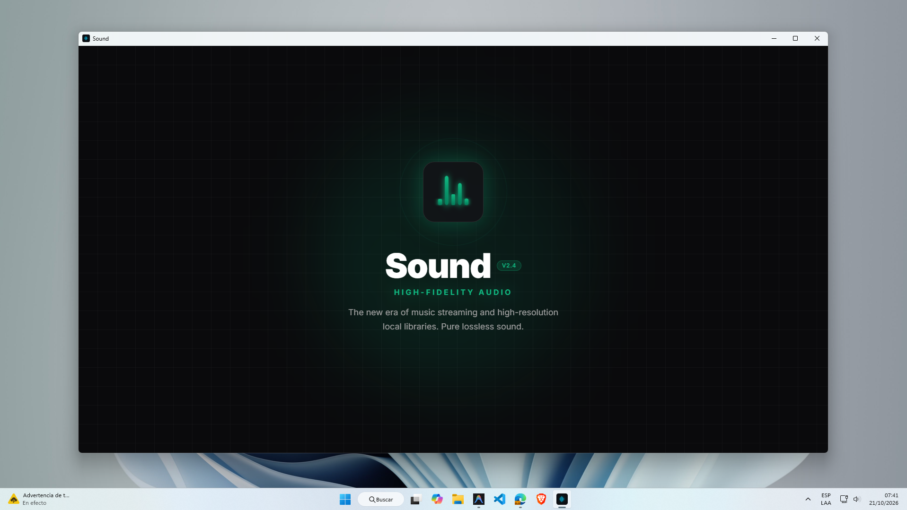 | 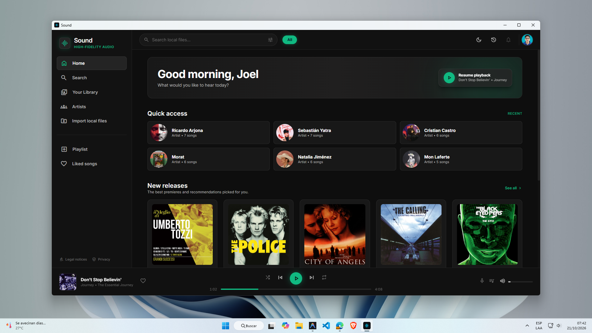 |

### 🎵 Reproductor & Biblioteca

| Player | Library |
|--------|---------|
| 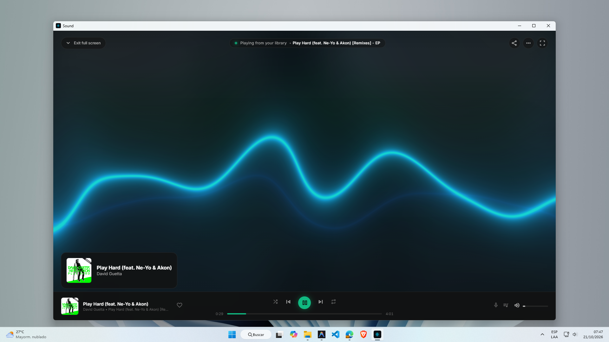 | 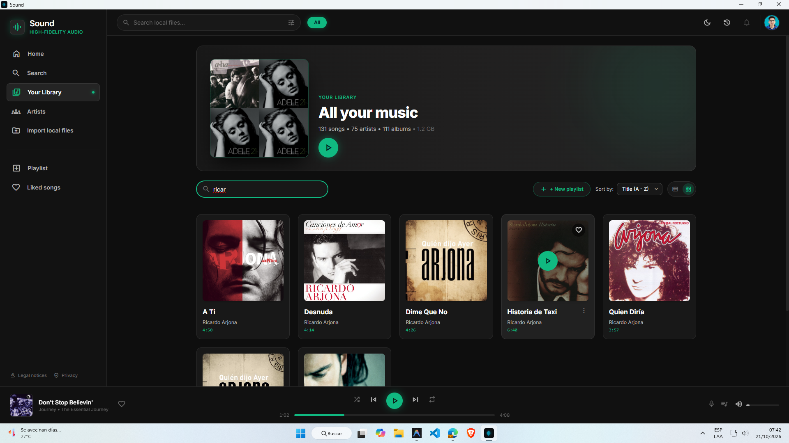 |

### 🔍 Búsqueda & Artistas

| Search | Search Results | Artists |
|--------|---------------|---------|
| 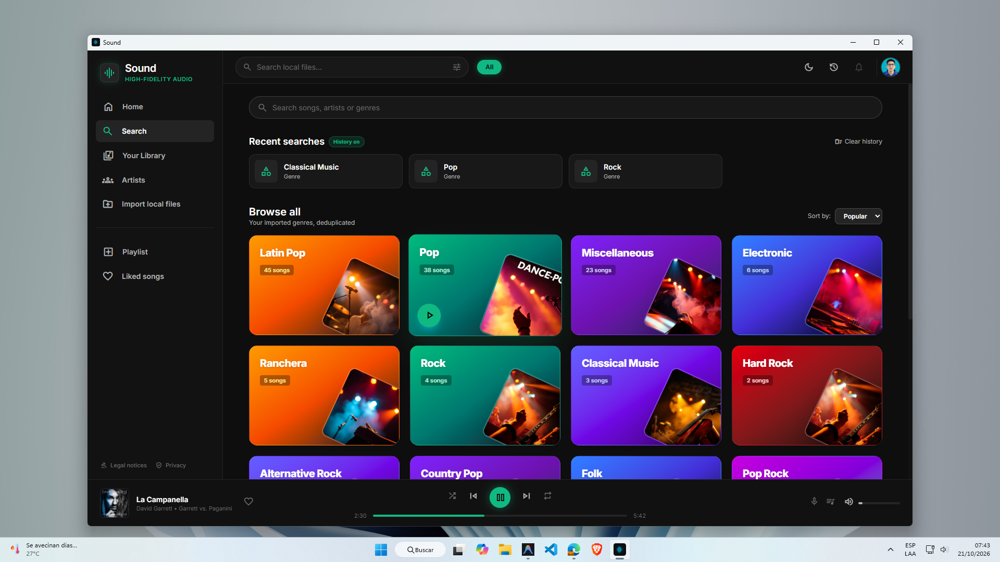 | 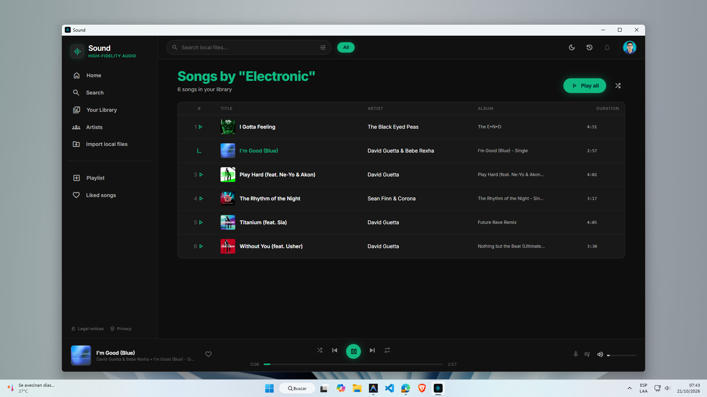 | 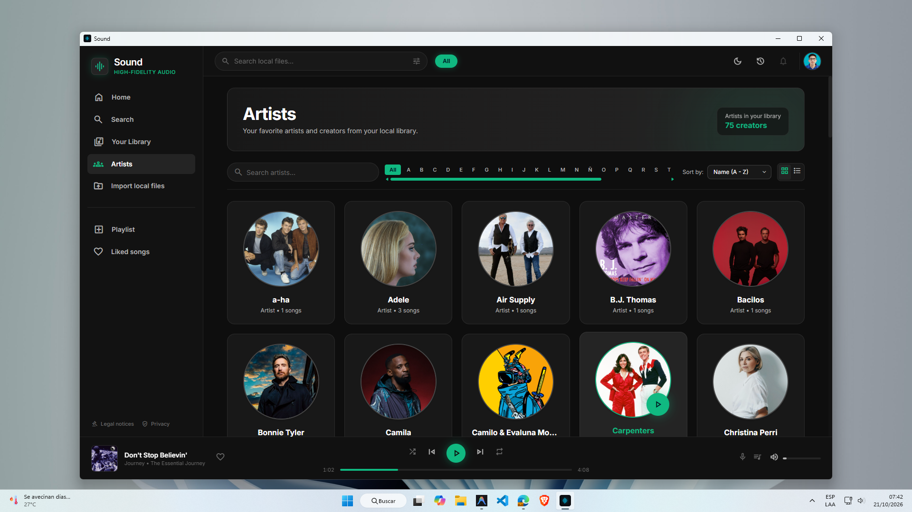 |

### 📋 Cola & Preferencias

| Queue | User Preferences | Profile |
|-------|-----------------|---------|
| 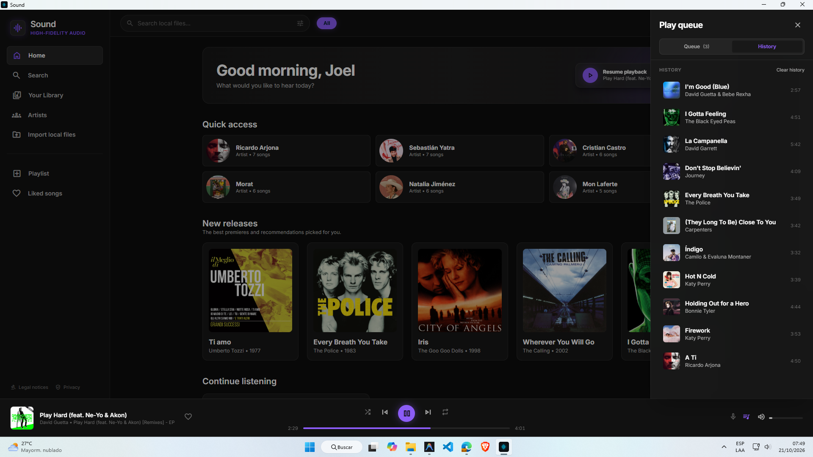 | 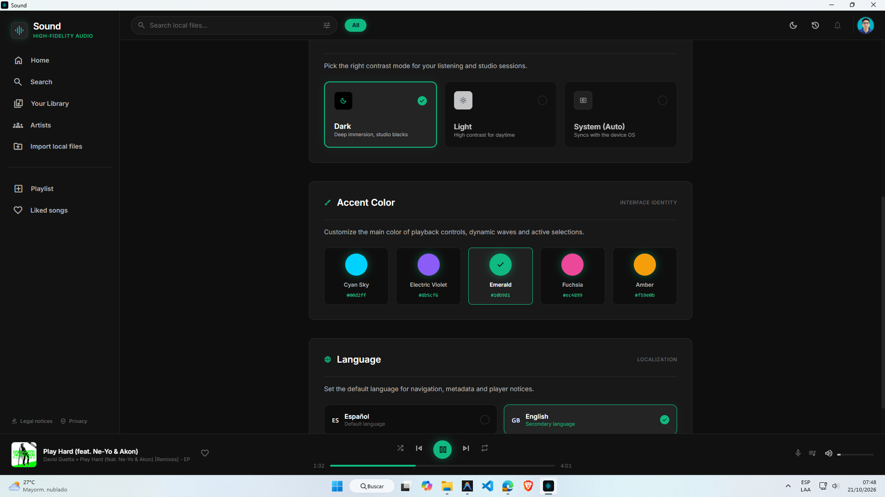 | 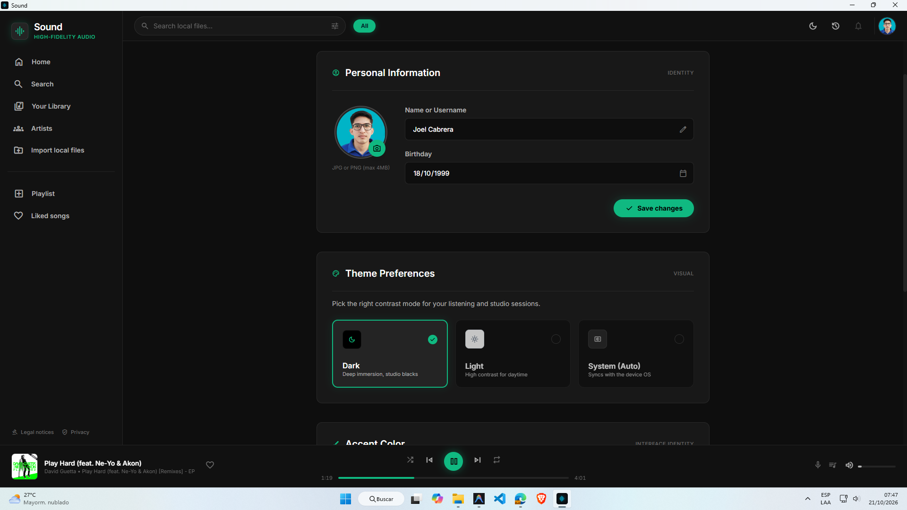 |

### 📂 Importar Archivos Locales

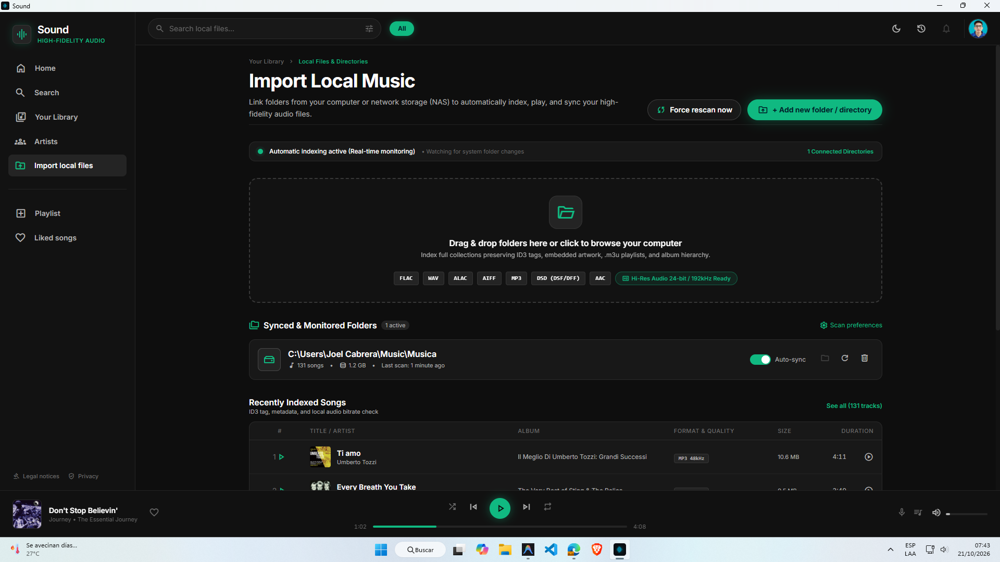

---

## Estructura del Repositorio

```
sound-music-player/
├── sound-desktop-app/          # Aplicación Electron + Angular
│   ├── electron/
│   │   ├── main.js             # Proceso principal Electron
│   │   └── preload.js          # contextBridge (electronAPI)
│   ├── src/
│   │   ├── app/
│   │   │   ├── welcome/        # Flujo de bienvenida (3 páginas)
│   │   │   │   ├── welcome-app/       # Splash de marca
│   │   │   │   ├── initial-setup/     # Perfil de usuario
│   │   │   │   └── general-setup/     # Sincronización + biblioteca
│   │   │   ├── media-player/    # Reproductor y biblioteca
│   │   │   ├── playlist/        # Listas de reproducción
│   │   │   └── shared/          # Servicios, pipes, i18n, guards
│   │   │   ├── app.ts           # Componente raíz
│   │   │   ├── app.routes.ts    # Rutas maestras
│   │   │   └── app.config.ts    # Configuración Angular
│   │   ├── main.ts              # Bootstrap Angular
│   │   └── styles.css
│   ├── package.json
│   ├── angular.json
│   └── README.md
├── frontend-design/            # Diseños Figma (ignorados en git)
├── README.md
└── .gitignore
```

## Quick Start (Desarrollo Local)

### Prerrequisitos

- Node.js >= 20
- npm

### 1. Instalar dependencias

```bash
cd sound-desktop-app
npm install
```

### 2. Ejecutar en modo desarrollo

```bash
npm run electron-dev
```

Esto levanta el servidor Angular en `http://localhost:4205` y abre Electron conectado a él.

### Comandos disponibles

| Comando                | Descripción                          |
| ---------------------- | ------------------------------------ |
| `npm start`            | Servidor Angular (puerto 4205)       |
| `npm run electron`     | Electron solamente                   |
| `npm run electron-dev` | Angular + Electron juntos            |
| `npm run build`        | Build de producción (Angular)        |
| `npm test`             | Ejecutar suite de pruebas (44 tests) |
| `npm run watch`        | Build en modo watch                  |

## Pruebas

El proyecto incluye **44 tests unitarios** que cubren componentes, servicios y el flujo de bienvenida. Todos pasan.

```bash
npm test
```

## Licencia

MIT — Joel Cabrera
